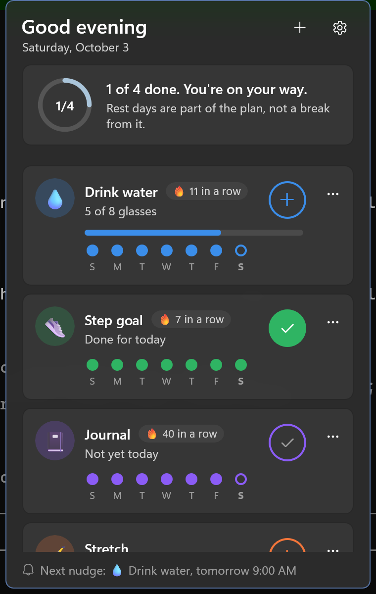
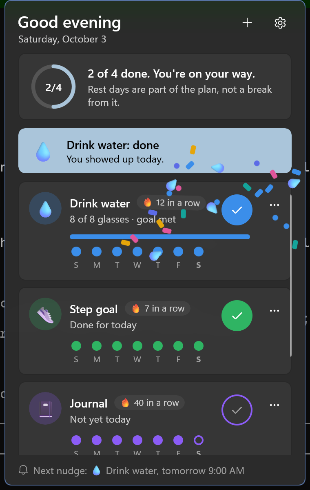
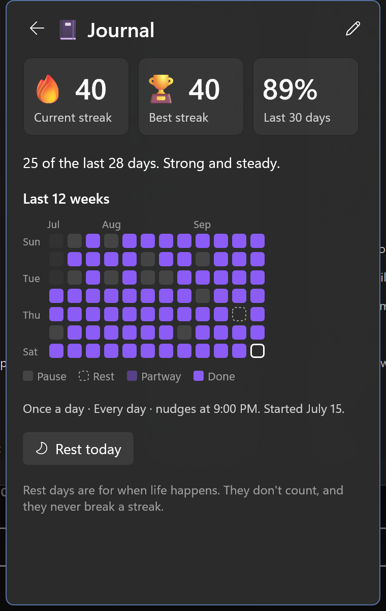
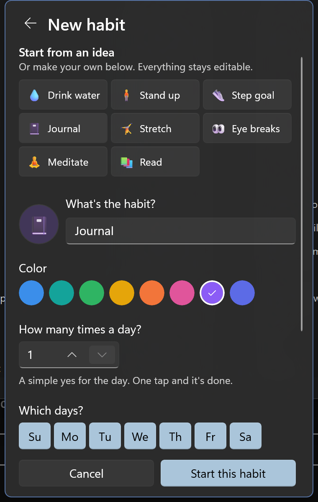

# Tray Nudge



Gentle reminders and kind streaks for the small habits that add up: drinking water, standing up, getting your steps, journaling, or anything else you want to do regularly.

Tray Nudge is not a to-do list. Tasks get finished and disappear; habits repeat. Tray Nudge is built around regularity: it nudges you at the right moments, celebrates every check-in, and treats a missed day as a pause rather than a failure, so the habit can actually stick.

It's a WinUI 3 app that lives in the Windows notification area. There's no main window. Click the tray icon and a small flyout opens next to it; click away and it's gone.

## What it does

- **Today at a glance.** A greeting, a progress ring for the day ("2 of 4 done. You're on your way."), a tip about building habits, and a card for each habit.
- **One-tap logging.** Each card has a round button. Yes-or-no habits (journal, steps) take one tap. Counted habits (8 glasses of water, 8 stand-ups) take a tap per glass, with a progress bar that fills as you go.
- **Streaks and regularity.** Every card shows its current streak and the last seven days as dots. Tap a habit's name for its progress page: current and best streak, how many of the last 30 days you showed up, and a 12-week heatmap.
- **Gentle nudges.** Each habit can remind you every so often within a window (every 90 minutes from 9 AM to 6 PM), hourly at a set minute (every hour at :50, or every 2 hours on the hour), or at set times (9 PM). Toasts have **Log one** / **Done** and **Later** (30 minutes) buttons, so you can check in without opening anything. Nudges stop for the day once the goal is met, and interval and hourly nudges skip a turn if you've just logged one.
- **Kind by design.**
  - **Never miss twice** (on by default): one missed day doesn't reset a streak, as long as you pick it back up the next day.
  - **Rest days**: mark today as a rest day for any habit. It doesn't count, and it never breaks a streak.
  - Days off in a habit's schedule (weekends for "Stand up", say) never count against you.
  - Missed days are drawn as quiet empty dots, never in red, and the words are encouraging: "Fresh start. Picking it back up is the habit."
- **Celebrations.** Logging pops the button and throws a little sparkle. Reaching a day's goal bursts confetti, some of it the habit's own emoji (water drops for water), and shows a banner. Finishing everything rains confetti across the flyout. Milestones (3, 7, 14, 21, 30, 66, 100 days) get their own words. Celebrations can be turned off and respect Windows' "Animation effects" setting.
- **Ideas to start from.** Drink water, Stand up, Step goal, Journal, Stretch, Eye breaks, Meditate, and Read fill in a sensible goal, schedule, and nudges. Every field stays editable: name, emoji, color, times per day, days of the week, and nudges.



| Progress | New habit |
|---|---|
|  |  |

### Tray icon and menu

- **Left-click** toggles the flyout. It always opens on Today.
- **Right-click** for Open, Add a habit, Pause nudges for an hour (or Resume), Settings, and Exit.
- The **tooltip** shows today's progress, such as "2 of 4 done today".
- The icon follows the taskbar's light or dark theme.
- Launching the app again opens the running instance's flyout instead of adding a second icon.

### Settings

Settings is a page inside the flyout: gentle nudges on or off, pause for an hour, never miss twice, celebrations, and Start with Windows.

### Keyboard

Escape goes back from a sub-page, then closes the flyout. Alt+Left and the mouse back button also go back.

## Install

Grab the signed MSIX for your architecture (x64 or ARM64) from the [latest release](../../releases/latest) and open it to install. If Windows says the publisher isn't trusted, install the signing certificate into **Trusted People** (Local Machine) first.

Requirements: Windows 10 1809 (build 17763) or later, or Windows 11, on x64 or ARM64.

## Setup

None. There are no accounts or API keys. Add a habit from the flyout and you're set.

## Privacy and footprint

- **No network access at all.** The package doesn't declare the `internetClient` capability. Nothing leaves your PC.
- Habits and history live in `habits.json` in the app's local folder (`%LOCALAPPDATA%\Packages\<package>\LocalState`). History older than about 400 days is pruned. Settings are in the app's LocalSettings. Uninstalling removes both.
- **One timer while idle.** Reminders are the app's only background work. Instead of polling, it sleeps on a single timer until the next nudge is due, waking at least every 30 minutes and at midnight to catch clock changes and the new day. A nudge that came due while the PC slept is shown only if it's under 10 minutes old, so waking up never produces a burst of stale reminders.
- **Small when hidden.** The flyout hides when dismissed and closes for real after a minute hidden, then memory is handed back to Windows. Measured idle working set is about 13 MB.

## Build from source

Prerequisites:

- [.NET 10 SDK](https://dotnet.microsoft.com/download)
- The winapp CLI: `winget install Microsoft.WinAppCli`
- **Developer Mode** turned on (Settings > System > For developers), so the app can be registered with package identity

```powershell
winapp run                 # build, register, and launch with package identity
winapp run --clean         # start from a clean state to see first run again
winapp run -c Release      # trimmed + ReadyToRun, as shipped
dotnet test TrayNudge.Tests
```

On first run the flyout opens by the tray with one clear next step. After that the app runs from the tray only; look in the taskbar overflow (^) if the icon is hidden.

To build signed x64 and ARM64 MSIX packages and a draft GitHub release, run `build-msix-for-gh.ps1`.

### Project layout

| Path | What it holds |
|---|---|
| `Core/` | Pure, WinRT-free logic: the `Habit` model, `StreakCalculator`, `ReminderPlanner`, `Encouragement` (every word the app says about progress), templates, and the JSON data file |
| `TrayNudge.Tests/` | MSTest project that compiles `Core/` directly and covers streaks, reminders, wording, and storage |
| `App.xaml.cs` | Tray icon, context menu, single instance, toast actions, the only exit path |
| `Views/TrayFlyoutWindow` | The borderless flyout: placement, light dismiss, slide and fade, page navigation, and the confetti layer |
| `Views/FlyoutPage` | Today: greeting, progress ring, habit cards, celebration banner, next-nudge footer |
| `Views/HabitCard` | One habit: log button, streak pill, progress bar, week dots |
| `Views/HabitEditorPage`, `HabitDetailPage`, `SettingsPage` | Sub-pages inside the flyout |
| `Controls/Motion.cs` | Pops, wiggles, number bumps, confetti bursts and rain, all on the composition thread |
| `Services/HabitStore.cs` | Loads and saves `habits.json` (atomic writes) and logs progress |
| `Services/ReminderService.cs` | The single reminder timer, snoozes, pause, and the tray tooltip |
| `Services/NotificationService.cs` | Nudge and confirmation toasts, one per habit tag |

### Troubleshooting

- **No nudges:** check that Gentle nudges is on in Settings and not paused, and that notifications for Tray Nudge are allowed in Windows Settings > System > Notifications. Focus sessions and Do Not Disturb also hold toasts back.
- **The app crashes:** unhandled exceptions are appended to `%TEMP%\TrayNudge-crash.log`.
- **Remove the dev registration:** run `winapp unregister` from the repository root.

## License

MIT, see [LICENSE](LICENSE).
